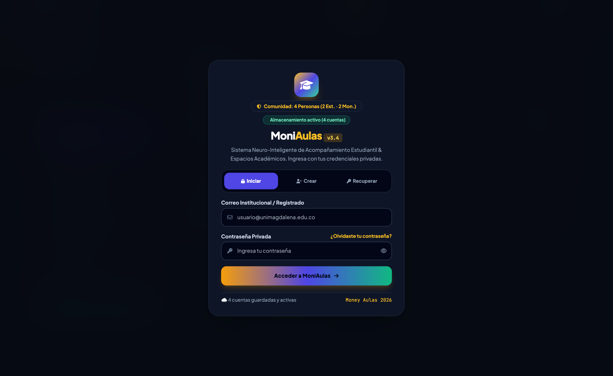
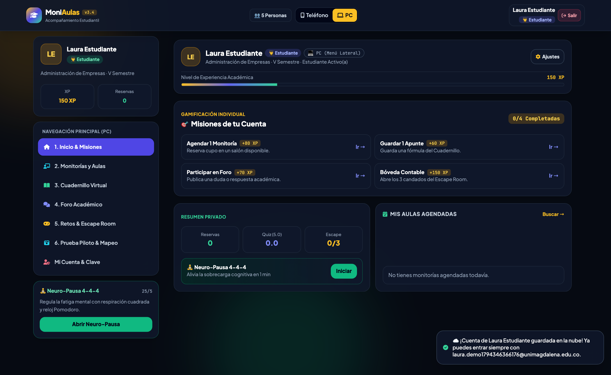
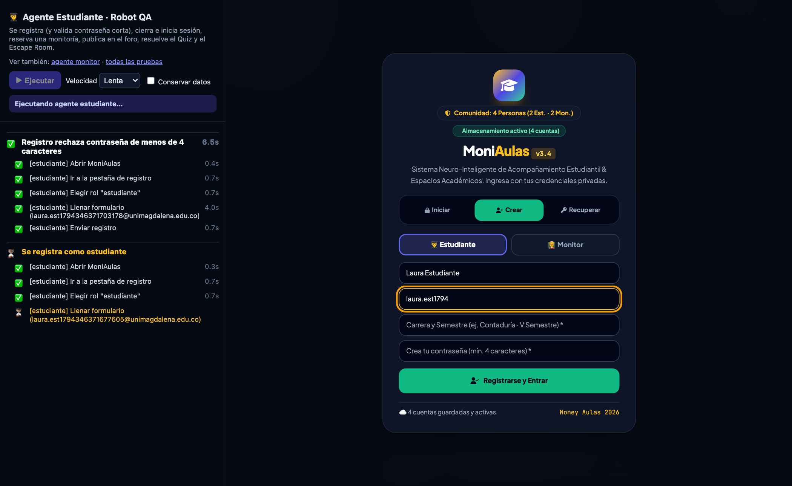
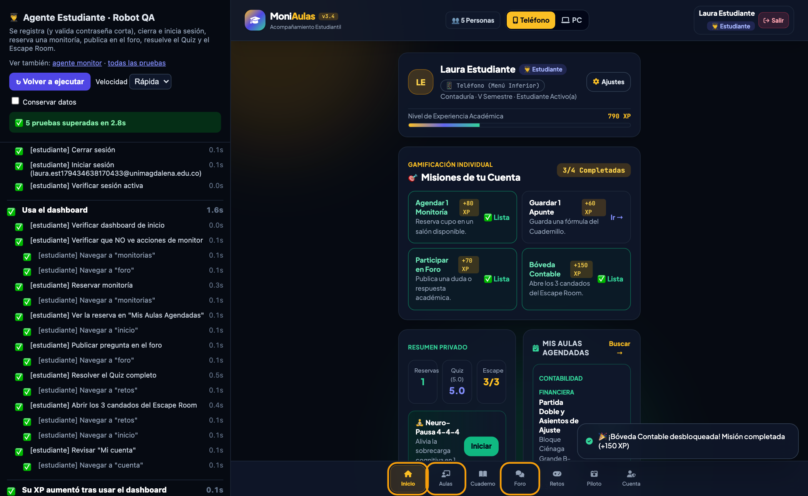
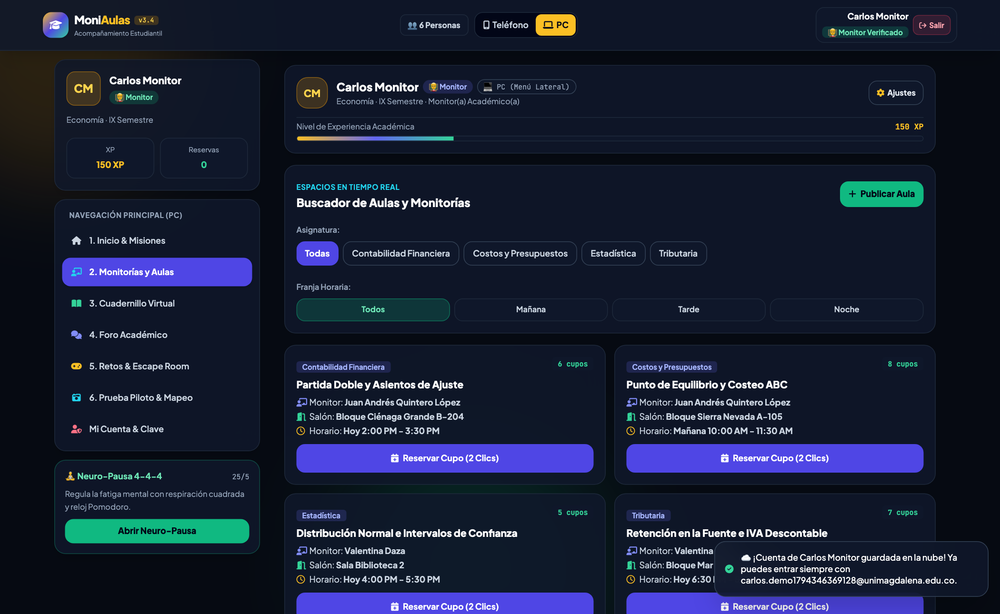
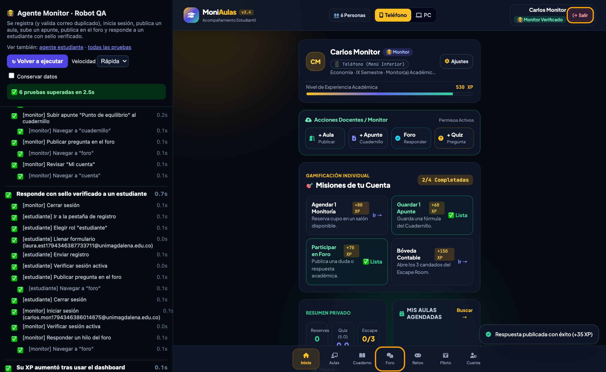
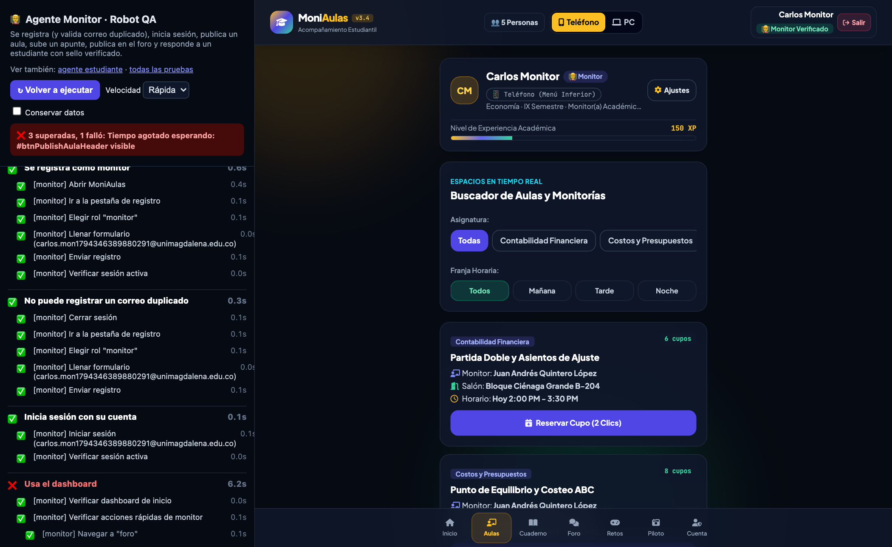
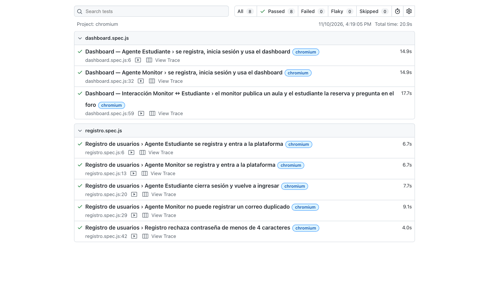

# MoniAulas: guía paso a paso para probar el proyecto con agentes de IA

**Dirigida a:** estudiantes de Administración de Empresas
**Proyecto:** MoniAulas, plataforma de acompañamiento estudiantil y monitorías académicas
**Sitio:** <https://moniaulas.vercel.app>

---

## Contenido

1. [¿Qué es MoniAulas?](#1-qué-es-moniaulas)
2. [Conceptos clave explicados para administradores](#2-conceptos-clave-explicados-para-administradores)
3. [Cómo se usó la Inteligencia Artificial en el proyecto](#3-cómo-se-usó-la-inteligencia-artificial-en-el-proyecto)
4. [Paso a paso: probar como Estudiante](#4-paso-a-paso-probar-como-estudiante)
5. [Paso a paso: probar como Monitor](#5-paso-a-paso-probar-como-monitor)
6. [Cómo leer los resultados (y qué hacer si algo falla)](#6-cómo-leer-los-resultados-y-qué-hacer-si-algo-falla)
7. [Opcional: probar desde VS Code](#7-opcional-probar-desde-vs-code)
8. [Valor para el negocio](#8-valor-para-el-negocio)
9. [Buenas prácticas y riesgos al usar IA](#9-buenas-prácticas-y-riesgos-al-usar-ia)
10. [Actividad para clase](#10-actividad-para-clase)
11. [Glosario](#11-glosario)

---

## 1. ¿Qué es MoniAulas?

**El problema.** En la universidad, muchos estudiantes necesitan refuerzo en materias como
Contabilidad Financiera, Costos y Presupuestos, Estadística o Tributaria. Las monitorías existen,
pero suele ser difícil saber **cuándo** y **dónde** hay una, cuántos **cupos** quedan y cómo
**prepararse**.

**La solución.** MoniAulas es una plataforma web que conecta a dos tipos de usuarios:

| Rol | ¿Quién es? | ¿Qué puede hacer? |
|---|---|---|
| 👨‍🎓 **Estudiante** | Quien busca apoyo académico | Reservar cupos en monitorías, preguntar en el foro, estudiar en el cuadernillo y practicar con retos (Quiz y Escape Room) |
| 👨‍🏫 **Monitor** | Estudiante avanzado que enseña | Publicar aulas o monitorías, subir apuntes, crear preguntas de Quiz y responder en el foro con **sello verificado** |

**Módulos del dashboard (panel principal):**

- **Inicio y misiones:** progreso, puntos de experiencia (XP) y metas, es decir, *gamificación*.
- **Monitorías y aulas:** buscador de salones y horarios con reserva en 2 clics.
- **Cuadernillo virtual:** apuntes y fórmulas por materia.
- **Foro académico:** preguntas y respuestas entre estudiantes y monitores.
- **Retos:** Quiz con nota de 0 a 5 y un Escape Room contable de 3 candados.
- **Mi cuenta:** datos del usuario y cambio de clave.





---

## 2. Conceptos clave explicados para administradores

### ¿Qué es "probar" un software (QA)?

**QA** (*Quality Assurance*, aseguramiento de la calidad) es el control de calidad de un producto
digital. Es lo mismo que hace una fábrica antes de despachar un lote: revisar que el producto
cumpla lo prometido **antes** de que llegue al cliente.

> **Analogía de negocio: el "cliente incógnito".**
> Muchas empresas contratan *mystery shoppers*: personas que se hacen pasar por clientes para
> evaluar el servicio. Nuestros **agentes** son clientes incógnitos digitales: entran a la app,
> se registran, compran (reservan), preguntan y verifican que todo funcione.

### ¿Qué es un agente?

Un **agente** es un programa que **actúa en nombre de una persona** siguiendo un objetivo.
En este proyecto hay dos:

- **Agente Estudiante:** se comporta como Laura, una estudiante de Contaduría.
- **Agente Monitor:** se comporta como Carlos, un monitor de Economía.

Cada agente escribe en los formularios **letra por letra**, pulsa botones y **verifica** que la
app responda lo esperado. Por ejemplo, comprueba que aparezca "Reserva confirmada (+60 XP)".

### ¿Qué es una prueba automatizada?

Es una **lista de chequeo que se ejecuta sola**. En lugar de que una persona revise 40 puntos a
mano cada vez que cambia la app, el robot lo hace en segundos y siempre de la misma manera.

| Concepto técnico | Equivalente en administración |
|---|---|
| Caso de prueba | Procedimiento estándar de verificación |
| Paso (*step*) | Actividad dentro de un proceso |
| Aserción ("debe mostrar X") | Indicador de cumplimiento (sí / no) |
| Prueba superada ✅ | Proceso conforme |
| Prueba fallida ❌ | No conformidad que debe corregirse |
| Reporte de pruebas | Informe de auditoría |

---

## 3. Cómo se usó la Inteligencia Artificial en el proyecto

El robot de pruebas, su documentación y su publicación en internet se construyeron
**conversando con un asistente de IA** (GitHub Copilot) dentro de **VS Code**, el editor de código.
La persona **no escribió el código a mano**: dio instrucciones en español, como se le
habla a un colaborador.

### 3.1 Las instrucciones (prompts) que se usaron

Estas fueron, de forma resumida, las peticiones reales:

1. *"Termina el robot que estabas haciendo para que realice las pruebas sobre el proyecto. Agente
   estudiante y agente monitor. Muéstrame en VS Code la ejecución de cada prueba: que se registre,
   inicie sesión y que use el dashboard."*
2. *"Explícame cómo probar como monitor y cómo probar como estudiante. Documéntalo en un .md.
   Súbelo al repositorio, despliégalo en Vercel y dame dos URL: una que ejecute el test como
   estudiante y otra como monitor."*
3. *"Explícalo paso a paso en un archivo .md y PDF. Diseña una presentación explicando todo el
   proyecto, enfocada en estudiantes de Administración de Empresas."*

> 💡 **Lección para administradores:** un buen *prompt* se parece a una buena **orden de trabajo**.
> Dice **qué** se quiere (pruebas), **para quién** (estudiante y monitor), **qué debe cubrir**
> (registro, sesión, dashboard) y **cómo se entrega** (en VS Code, en .md, con URL).

### 3.2 Lo que hizo la IA, paso a paso

| # | Fase | Qué hizo la IA | Analogía de gestión |
|---|---|---|---|
| 1 | **Diagnóstico** | Leyó la app (más de 4.000 líneas) para entender pantallas, botones y reglas | Levantamiento de procesos |
| 2 | **Diseño** | Definió un agente base y dos agentes especializados: Estudiante y Monitor | Diseño de cargos y funciones |
| 3 | **Construcción** | Escribió las pruebas: registro, inicio de sesión, reservas, foro, Quiz, Escape Room, publicar aula y subir apunte | Elaboración de procedimientos |
| 4 | **Ejecución** | Corrió las pruebas: 4 fallaron la primera vez | Prueba piloto |
| 5 | **Mejora continua** | Analizó cada fallo, encontró la causa y corrigió (ver 3.3) | Ciclo PHVA (Planear-Hacer-Verificar-Actuar) |
| 6 | **Validación** | Volvió a ejecutar: 10 de 10 pruebas superadas | Auditoría de cierre |
| 7 | **Publicación** | Subió el código a GitHub y lo desplegó en Vercel con 2 URL públicas | Lanzamiento al mercado |
| 8 | **Documentación** | Escribió guías, esta guía en PDF y la presentación | Manual de procesos |

### 3.3 Problemas reales que la IA detectó y resolvió

| Síntoma | Causa encontrada | Solución |
|---|---|---|
| El inicio de sesión fallaba después de cerrar sesión | La app **deja escrito el último correo** y el robot lo escribía otra vez, quedando duplicado | Borrar el campo antes de escribir |
| El robot no encontraba el menú | En pantallas grandes la app usa **menú lateral** y no la barra inferior del celular | Usar el menú que esté visible |
| Error "botón ambiguo" | Había **dos botones** llamados "Publicar Aula" | Buscar el botón dentro de la ventana correcta |
| Se acababa el tiempo | Los recorridos completos tardan más de 30 s | Ampliar el tiempo máximo a 120 s |

> 💡 **Lección:** la IA **no acierta siempre a la primera**, igual que un empleado nuevo. Su valor
> está en que **verifica, aprende del error y corrige rápido**. El rol humano es **definir el
> objetivo, revisar y aprobar**.

### 3.4 Herramientas utilizadas

| Herramienta | Para qué sirve | Analogía |
|---|---|---|
| **VS Code** | Editor donde se trabaja el proyecto | La oficina |
| **GitHub Copilot (IA)** | Asistente que escribe, prueba y documenta | El consultor |
| **Playwright** | Motor que controla el navegador como un usuario | El cliente incógnito |
| **GitHub** | Guarda el historial de versiones del proyecto | El archivo documental |
| **Vercel** | Publica la app en internet | El local comercial abierto al público |

---

## 4. Paso a paso: probar como Estudiante

> No necesitas instalar nada. Solo un navegador (Chrome, Edge, Safari o Firefox) y conexión a internet.

### Paso 1: Abre el enlace

👉 **<https://moniaulas.vercel.app/qa/estudiante>**

La prueba **empieza sola** al cargar la página.

### Paso 2: Observa la pantalla dividida

- **Izquierda:** la *bitácora*, es decir, la lista de pasos que va ejecutando el robot.
- **Derecha:** la app MoniAulas real, manejada por el robot.
  Cada botón o campo que va a usar se **resalta en naranja**.



### Paso 3: Sigue lo que hace el Agente Estudiante

| # | Prueba | ¿Qué verifica? |
|---|---|---|
| 1 | **Registro rechaza contraseña corta** | Si la clave tiene menos de 4 caracteres, la app **no** deja registrarse (control de seguridad) |
| 2 | **Se registra como estudiante** | Crea la cuenta de *Laura Estudiante* y entra con el rol 👨‍🎓 Estudiante |
| 3 | **Cierra sesión y vuelve a entrar** | Sale de la app y vuelve a ingresar con su correo y contraseña |
| 4 | **Usa el dashboard** | Revisa su panel y confirma que **no** ve opciones de monitor. Reserva una monitoría (la app le exige escribir el tema a repasar). Ve la reserva en "Mis Aulas Agendadas", pregunta en el foro, resuelve el Quiz, abre los 3 candados del Escape Room y revisa su cuenta |
| 5 | **Su XP aumentó** | Confirma que ganó puntos de experiencia por participar |

### Paso 4: Revisa el resultado

Arriba a la izquierda aparecerá un recuadro **verde** como este:

> ✅ **5 pruebas superadas en 21.4s**



### Paso 5 (opcional): Ajusta la prueba

- **Velocidad:** elige *Lenta* para presentarla en clase o *Rápida* para verificar en segundos.
  También puedes abrir directamente <https://moniaulas.vercel.app/qa/estudiante?velocidad=lenta>.
- **↻ Volver a ejecutar:** repite toda la prueba con un usuario nuevo.

---

## 5. Paso a paso: probar como Monitor

### Paso 1: Abre el enlace

👉 **<https://moniaulas.vercel.app/qa/monitor>**

### Paso 2: Sigue lo que hace el Agente Monitor

| # | Prueba | ¿Qué verifica? |
|---|---|---|
| 1 | **Se registra como monitor** | Crea la cuenta de *Carlos Monitor* y entra con el rol 👨‍🏫 Monitor Verificado |
| 2 | **No puede registrar un correo duplicado** | Intenta registrarse otra vez con el mismo correo y la app lo **impide** (control de datos únicos) |
| 3 | **Inicia sesión con su cuenta** | Ingresa con correo y contraseña |
| 4 | **Usa el dashboard** | Ve las *Acciones Docentes*. Publica un aula (la app exige todos los datos: tema, salón, cupos y horario) y sube un apunte al cuadernillo. También publica un aviso en el foro y revisa su cuenta |
| 5 | **Responde con sello verificado** | Un estudiante hace una pregunta y el monitor responde. Su respuesta aparece con **✅ Monitor Verificado** |
| 6 | **Su XP aumentó** | Confirma que ganó puntos por su gestión |



### Paso 3: Revisa el resultado

> ✅ **6 pruebas superadas en 29.5s**



---

## 6. Cómo leer los resultados (y qué hacer si algo falla)

| Símbolo | Significado | ¿Qué hacer? |
|---|---|---|
| ⏳ | El paso está en ejecución | Esperar |
| ✅ | El paso se cumplió | Nada, todo está bien |
| ❌ | El paso **no** se cumplió | Leer el mensaje rojo y reportarlo |

### Ejemplo de un fallo

Para mostrar cómo se ve un error, **simulamos** que el botón "Publicar Aula" desapareció de la app.
El robot lo detectó de inmediato:



El mensaje dice: **"3 superadas, 1 falló: Tiempo agotado esperando: #btnPublishAulaHeader visible"**.
En lenguaje de negocio significa: *"el monitor no pudo publicar un aula porque el botón no
apareció"*. Con esa información, el equipo de desarrollo sabe **exactamente** qué revisar.

### ¿Cómo reportar un fallo? (formato sugerido)

1. **¿Qué agente?** Estudiante o Monitor.
2. **¿Qué paso falló?** El que tiene ❌.
3. **Mensaje de error:** copiar el texto rojo.
4. **Captura de pantalla.**
5. **Fecha y navegador usado.**

> 🔒 **¿Se dañan mis datos?** No. El robot guarda una copia de los datos de MoniAulas de tu
> navegador antes de empezar, trabaja con datos limpios y al terminar **restaura todo**.

---

## 7. Opcional: probar desde VS Code

Esta opción es para quien quiera ver el "detrás de cámaras", con video y reporte detallado.

1. Instala **Node.js** y **VS Code**.
2. Descarga el proyecto: `git clone https://github.com/josebruges/moniaulas.git`
3. Abre la carpeta en VS Code y, en la terminal, ejecuta:
   ```bash
   npm install
   npx playwright install chromium
   ```
4. Ejecuta las pruebas con el navegador visible:
   - Como estudiante: `npm run test:estudiante`
   - Como monitor: `npm run test:monitor`
5. Mira el reporte con video, capturas y cada paso: `npm run report`

También puedes instalar la extensión **Playwright Test for VS Code** y usar el panel **Testing**
(ícono 🧪) con la opción **Show browser** activada.



---

## 8. Valor para el negocio

| Indicador | Prueba manual (estimado) | Prueba con agentes (medido) |
|---|---|---|
| Tiempo por rol | ~10–15 min por persona | **21 s** (Estudiante) y **30 s** (Monitor) |
| Verificaciones por corrida | Depende de la atención del evaluador | **37 a 44 pasos**, siempre iguales |
| Costo de repetir | Horas-persona cada vez | Prácticamente cero: un clic |
| Evidencia | Notas a mano | Bitácora, capturas, video y reporte |
| Disponibilidad | Horario laboral | 24/7 desde cualquier navegador |

> *Los tiempos manuales son una estimación de referencia para clase. Los tiempos de los agentes
> se midieron en la versión publicada a velocidad normal.*

**¿Por qué le importa esto a un administrador?**

- **Calidad y reputación:** un error en el registro significa **clientes perdidos**. Las pruebas
  los detectan antes que el usuario.
- **Productividad:** el equipo deja de repetir tareas mecánicas y se enfoca en mejorar el producto.
- **Toma de decisiones con datos:** cada corrida deja evidencia objetiva (✅/❌), igual que un KPI.
- **Escalabilidad:** se pueden añadir nuevos "clientes incógnitos" (agentes) para nuevos procesos.

---

## 9. Buenas prácticas y riesgos al usar IA

| ✅ Buenas prácticas | ⚠️ Riesgos a controlar |
|---|---|
| Dar instrucciones claras: qué, para quién y cómo se entrega | Confiar ciegamente: la IA también se equivoca |
| Pedir que **verifique** su trabajo (ejecutar pruebas) | Compartir datos sensibles o contraseñas reales |
| Revisar y aprobar lo que entrega | Perder el conocimiento: hay que entender lo que se hizo |
| Iterar: pedir mejoras paso a paso | Depender de una sola herramienta |
| Documentar el proceso | No tener un responsable humano |

> **Regla de oro:** *la IA ejecuta, la persona decide.* El responsable del resultado sigue siendo
> el humano que define el objetivo y aprueba la entrega.

---

## 10. Actividad para clase

**Duración sugerida:** 30 minutos · **Trabajo:** parejas

1. **(5 min)** Abran <https://moniaulas.vercel.app/qa/estudiante?velocidad=lenta> y observen.
2. **(5 min)** Abran <https://moniaulas.vercel.app/qa/monitor?velocidad=lenta> y observen.
3. **(10 min)** Respondan:
   - ¿Qué **procesos de negocio** de MoniAulas verifica cada agente?
   - ¿Qué **controles** encontraron? Pista: contraseña corta, correo duplicado, campos obligatorios.
   - ¿Qué **otro agente** crearían? Por ejemplo, un "Agente Coordinador" que revise reportes.
4. **(10 min)** Redacten un **prompt** para pedirle a una IA ese nuevo agente. Incluyan:
   objetivo, rol, pasos que debe probar y cómo quieren el resultado.

**Lista de chequeo de la actividad**

- [ ] Ejecuté la prueba del Agente Estudiante y vi el resultado ✅
- [ ] Ejecuté la prueba del Agente Monitor y vi el resultado ✅
- [ ] Identifiqué al menos 3 controles de calidad de la app
- [ ] Propuse un nuevo agente con su prompt

---

## 11. Glosario

| Término | Definición sencilla |
|---|---|
| **Agente** | Programa que actúa como un usuario para cumplir un objetivo |
| **Aserción** | Comprobación de que algo es como se espera ("debe decir *Reserva confirmada*") |
| **Dashboard** | Panel principal con la información y acciones del usuario |
| **Despliegue** | Publicar la aplicación en internet |
| **Gamificación** | Uso de puntos, misiones y retos para motivar |
| **GitHub** | Plataforma que guarda las versiones del código |
| **Playwright** | Herramienta que controla el navegador de forma automática |
| **Prompt** | Instrucción escrita que se le da a una IA |
| **QA** | Aseguramiento de la calidad del software |
| **Vercel** | Servicio que publica sitios web |
| **VS Code** | Editor de código donde se trabaja con la IA |
| **XP** | Puntos de experiencia que gana el usuario en MoniAulas |

---

### Enlaces rápidos

| Recurso | URL |
|---|---|
| App MoniAulas | <https://moniaulas.vercel.app> |
| 👨‍🎓 Probar como Estudiante | <https://moniaulas.vercel.app/qa/estudiante> |
| 👨‍🏫 Probar como Monitor | <https://moniaulas.vercel.app/qa/monitor> |
| Índice de pruebas | <https://moniaulas.vercel.app/qa/> |
| Código fuente | <https://github.com/josebruges/moniaulas> |
